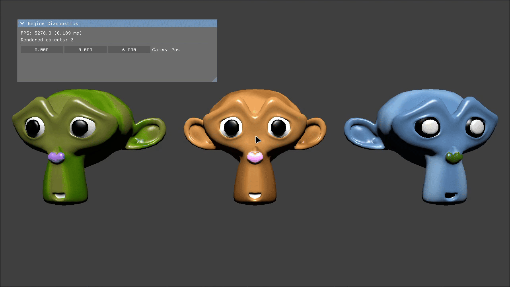

# MyEngine

[](https://en.cppreference.com/w/cpp/20)
[](https://www.vulkan.org/)
[](https://wiki.libsdl.org/SDL3/FrontPage)
[](https://shader-slang.org/)

A small real-time 3D renderer written in **C++20** on top of **Vulkan 1.3**. The main goal is to learn Vulkan and how to build a renderer from scratch. A longer-term goal is to explore **Signed Distance Fields (SDFs)** and turn this into a simple SDF model editor.

It skips the legacy Vulkan setup (render passes, framebuffers, per-object descriptor sets) and uses the 1.3 feature set instead: dynamic rendering, Synchronization2, buffer device address and descriptor indexing. Shaders are written in **Slang**.

The current demo renders three textured Suzanne models with Phong lighting, a free-fly camera and a Dear ImGui diagnostics window.

<p align="center">
  
</p>

## Features

- **Dynamic rendering** – no `VkRenderPass` / `VkFramebuffer`. The swapchain image and depth buffer are transitioned with Synchronization2 barriers and bound with `vkCmdBeginRendering` (`MppRenderer`).
- **Buffer device address** – per-frame scene data (projection, view, camera/light position, model and normal matrices for up to 128 objects) lives in one buffer per frame in flight. The shader gets a raw pointer to it through push constants, together with the object ID.
- **Texture array with descriptor indexing** – all textures sit in a single descriptor set as a runtime-sized, partially bound array of combined image samplers, indexed in the shader with `NonUniformResourceIndex`.
- **Slang shaders** – vertex and fragment stages live in one file (`assets/shader.slang`). It is compiled to SPIR-V at runtime through the Slang API, and the result is cached in `assets/shader.spv`. It is recompiled only when the `.slang` file is newer than the cache.
- **Assets** – Wavefront OBJ meshes via tinyobjloader, KTX textures via libktx, GPU memory via VMA.
- **Swapchain** – 2 frames in flight, MAILBOX present mode (IMMEDIATE as a fallback), recreated on window resize.
- **Dear ImGui (docking branch)** – rendered inside the same dynamic rendering pass. Shows FPS / frame time and the object count, and lets you edit the camera position. Mouse and keyboard input is not passed to the scene while ImGui has focus.
- **Error checking** – `chk()` helpers in `mpp_checks.hpp` use `std::source_location` to report the file and line of a failed `VkResult` or condition.
- **Frame timing** – delta time from `SDL_GetTicksNS()`, clamped to 0.1 s.

## Tech stack

| Part | Library | Where it comes from |
| :--- | :--- | :--- |
| Graphics API | Vulkan 1.3 | Vulkan SDK |
| Function loader | Volk | Vulkan SDK |
| Memory allocator | Vulkan Memory Allocator | Vulkan SDK |
| Shader compiler | Slang | Vulkan SDK (`libslang`) |
| Window / input | SDL3 | system package or SDK (`find_package(SDL3)`) |
| Math | GLM 1.0 | fetched by CMake (`FetchContent`) on non-Windows builds |
| UI | Dear ImGui (docking) | git submodule `external/imgui` |
| Textures | libktx (subset) | vendored in `external/ktx` |
| Meshes | tinyobjloader | vendored in `external/tinyobj` |

## Project structure

```text
MyEngine/
├── assets/                     # shader.slang, suzanne.obj/.mtl, suzanne0-2.ktx
├── external/                   # third-party code + its CMakeLists.txt
│   ├── imgui/                  # Dear ImGui (submodule)
│   ├── ktx/                    # libktx sources
│   └── tinyobj/                # tinyobjloader
├── include/                    # headers
├── src/                        # sources
├── TODO.md                     # current task list
└── CMakeLists.txt
```

Main classes (namespace `mpp`):

| File | Responsibility |
| :--- | :--- |
| `app` | Main loop, scene setup, ImGui init and shutdown |
| `mpp_window` | SDL3 window and Vulkan surface |
| `mpp_device` | Instance, physical/logical device, queues, VMA allocator, enabled features |
| `mpp_swap_chain` | Swapchain, depth images, recreation |
| `mpp_renderer` | Command buffers, sync objects, per-frame BDA buffers, begin/end frame and rendering |
| `mpp_pipeline` | Slang compilation / SPIR-V cache, graphics pipeline |
| `basic_render_system` | Pipeline layout, texture set layout, draw calls |
| `mpp_descriptors` | Builders for descriptor set layouts, pools and writes |
| `mpp_texture`, `mpp_model` | KTX textures, OBJ meshes |
| `mpp_game_object`, `mpp_camera` | Transforms, camera view/projection |
| `camera_controller`, `scene_input_handler` | Keyboard camera movement, object selection and rotation |

## Building

### Requirements

- A C++20 compiler (GCC, Clang or MSVC)
- CMake 3.20+ (Ninja optional)
- [Vulkan SDK](https://vulkan.lunarg.com/) with Slang, Volk and VMA, and the `VULKAN_SDK` environment variable set
- SDL3 that CMake can find
- A GPU and driver with Vulkan 1.3, `descriptorBindingPartiallyBound` and `runtimeDescriptorArray`

The project is developed on Linux, where the build targets Wayland (`VK_USE_PLATFORM_WAYLAND_KHR`). `CMakeLists.txt` also has Windows/MSVC settings.

### Steps

```bash
git clone --recursive https://github.com/Cudakowski/MyVulkanEngine.git MyEngine
cd MyEngine
# if you cloned without --recursive:
git submodule update --init --recursive

cmake -B build -G Ninja -DCMAKE_BUILD_TYPE=Release   # defaults to Debug if no build type is given
cmake --build build
```

### Running

The program looks for the `assets/` folder in the **current working directory**, so start it from the project root:

```bash
./build/bin/MyEngine
```

A post-build step also copies `assets/` next to the binary, so running it from `build/bin/` works too.

The repo also includes a VS Code gdb launch config (`.vscode/launch.json`).

## Controls

| Input | Action |
| :--- | :--- |
| <kbd>W</kbd> <kbd>A</kbd> <kbd>S</kbd> <kbd>D</kbd> | Move camera |
| <kbd>E</kbd> / <kbd>Q</kbd> | Move camera up / down |
| Arrow keys | Rotate camera |
| <kbd>+</kbd> / <kbd>-</kbd> | Select next / previous model (the selected one is highlighted) |
| Left mouse button + drag | Rotate the selected model |

## Roadmap

The full list is in [`TODO.md`](TODO.md). Main points:

- [x] Dynamic rendering, BDA and descriptor indexing
- [x] Runtime Slang compilation with SPIR-V cache
- [x] Dear ImGui integration
- [ ] Finish `MppBuffer` (buffer wrapper, not used yet)
- [ ] Texture / resource manager and loading textures at runtime
- [ ] Instanced drawing of objects that share a mesh
- [ ] Alpha blending option in `MppPipeline`
- [ ] Blinn-Phong and normal mapping
- [ ] Fix destroying the old swapchain too early
- [ ] Signed Distance Fields and a simple SDF model editor (longer-term)

## Credits

- Parts of the code are based on work by **Sascha Willems**: [Vulkan samples](https://github.com/SaschaWillems/Vulkan) (the work-in-progress `MppBuffer` is based on `VulkanBuffer`) and the shader in `assets/shader.slang` (MIT).
- Third-party libraries in `external/` keep their own licenses (see the `LICENSE` files in their folders).

## License

No license has been chosen yet.
